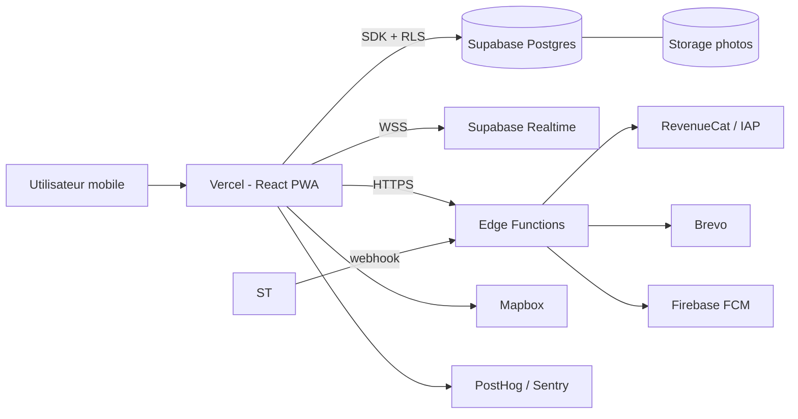
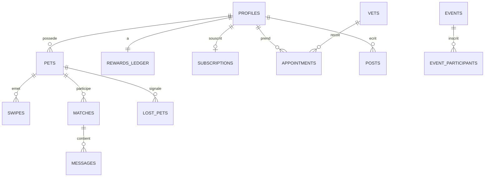
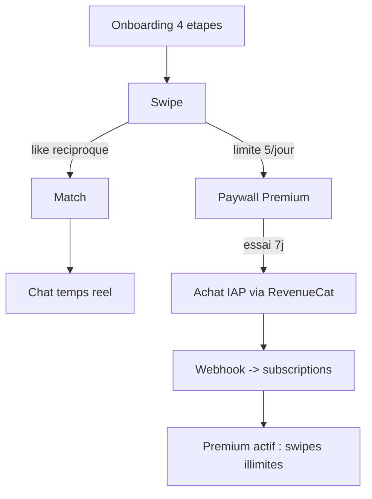
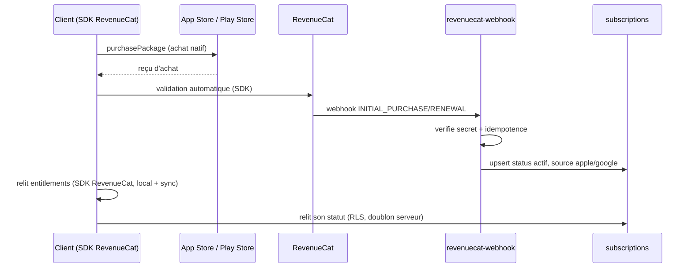
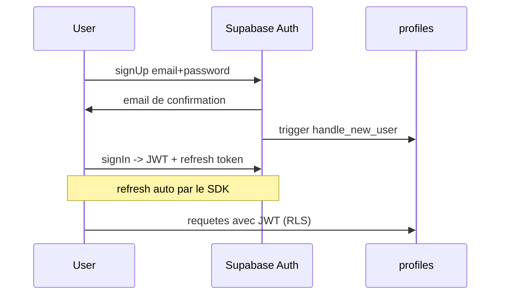
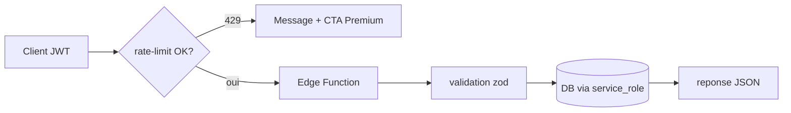

# Furrix — Documentation Technique Exhaustive

**Version** : 1.0 · **Date** : 2025 · **Audience** : équipe de développement (Alexis Goube — backend · Guillaume Cools — frontend/paiements)
**Objectif du document** : permettre à un développeur de reprendre le projet **sans poser une seule question** et de terminer l'intégration en **moins d'un mois**.

**Convention de lecture** :
- ✅ **Existant** — présent dans le code actuel (`furrix_final.jsx`)
- 🔶 **À construire** — recommandation d'implémentation (standards 2026), non présente dans le code

---

## Table des matières

1. [Présentation générale](#1-présentation-générale)
2. [Installation](#2-installation)
3. [Variables d'environnement](#3-variables-denvironnement)
4. [Supabase — guide complet](#4-supabase--guide-complet)
5. [Authentification](#5-authentification)
6. [Sécurité — audit complet](#6-sécurité--audit-complet)
7. [Limitation par IP et anti-abus](#7-limitation-par-ip-et-anti-abus)
8. [RevenueCat / IAP — intégration complète](#8-revenuecat--in-app-purchase--intégration-complète)
9. [API — référence des routes](#9-api--référence-des-routes)
10. [Base de données — dictionnaire](#10-base-de-données--dictionnaire)
11. [Front-end](#11-front-end)
12. [Backend](#12-backend)
13. [Déploiement](#13-déploiement)
14. [Maintenance](#14-maintenance)
15. [Performances](#15-performances)
16. [Roadmap technique](#16-roadmap-technique)
17. [Procédure de reprise du projet](#17-procédure-de-reprise-du-projet)
18. [Schémas (Mermaid)](#18-schémas-mermaid)
19. [Audit du code existant](#19-audit-du-code-existant)
20. [Plan d'action développeur — solo (Guillaume)](#20-plan-daction-développeur--solo-guillaume)
21. [Application mobile native (App Store & Play Store)](#21-application-mobile-native-app-store--play-store)
22. [Complexité par fonctionnalité](#22-complexité-par-fonctionnalité--où-concentrer-lattention)

---

## 1. Présentation générale

### 1.1 Objectif de l'application

Furrix est une **application web mobile-first (PWA)** tout-en-un pour propriétaires d'animaux : rencontre/matching entre animaux (type Tinder), soins (vétérinaires, téléconsultation, associations, assurances), communauté, événements, marketplace, carnet de santé, alertes animaux perdus. Modèle économique : **freemium B2C** (abonnement Premium 7,99 €/mois ou 59,99 €/an) + commissions B2B2C (vétérinaires, assurances, marketplace).

### 1.2 Architecture globale

Architecture **serverless** : aucun serveur applicatif à maintenir.

- **Client** : React 18 + Vite, hébergé sur Vercel (CDN edge)
- **BaaS** : Supabase — PostgreSQL, Auth, Storage, Realtime, Edge Functions (Deno)
- **Paiements** : RevenueCat (In-App Purchase Apple/Google — pas de Stripe, app mobile-only)
- **Services tiers** : Brevo (emails), Firebase FCM (push), Daily.co (visio, phase 2), Mapbox (cartes), PostHog (analytics), Sentry (erreurs)

> Diagramme d'architecture : voir [§18.1](#181-architecture-globale).

### 1.3 Technologies utilisées

| Couche | Technologie | Statut |
|---|---|---|
| UI | React 18, CSS-in-JS inline, Inter (Google Fonts) | ✅ |
| Build | Vite 5+ | 🔶 (le prototype est un fichier unique) |
| Icônes | Set SVG interne `ICON` (style Lucide) + illustrations `PAWS` | ✅ |
| BDD/Auth/Storage/Realtime | Supabase | 🔶 |
| Paiements | RevenueCat + IAP (Apple/Google) | 🔶 (simulé dans le prototype) |
| Emails | Brevo | 🔶 |
| Push | Firebase Cloud Messaging | 🔶 |
| Cartes | Mapbox GL JS | 🔶 (carte SVG France placeholder ✅) |
| Analytics / erreurs | PostHog / Sentry | 🔶 |

### 1.4 Arborescence cible du projet

Le code actuel est **un fichier unique** `furrix_final.jsx` (~1 708 lignes) contenant toute l'application. L'arborescence cible après découpage :

```
furrix/
├── public/                    # manifest PWA, favicon, service worker
├── src/
│   ├── lib/
│   │   ├── supabase.js        # client Supabase unique
│   │   ├── revenuecat.js      # helper RevenueCat (init + achats)
│   │   └── analytics.js       # PostHog + Sentry init
│   ├── data/
│   │   ├── matching.js        # computeScore, buildPool (✅ logique existante)
│   │   └── constants.js       # T (thème), SP (espèces), RW/EARN (récompenses)
│   ├── hooks/
│   │   ├── useAuth.js         # session Supabase
│   │   ├── useSwipe.js        # moteur swipe 60fps (✅ existant)
│   │   ├── useRetention.js    # streak / paws / xp (✅ existant)
│   │   ├── useChat.js         # messages Realtime
│   │   └── usePets.js         # CRUD animaux
│   ├── components/
│   │   ├── ui/                # Ic (icônes), PetAvatar, PetPhoto, Toast, Skeleton
│   │   ├── SwipeCard.jsx
│   │   ├── ProfileModal.jsx   # fiche animal détaillée
│   │   ├── PremiumModal.jsx   # paywall
│   │   ├── RewardsModal.jsx   # PawPoints
│   │   ├── BottomNav.jsx
│   │   └── tabs/              # Discover, Soins, Communaute, Matchs, Events, Moi
│   ├── Onboarding.jsx         # 4 étapes (✅ logique existante)
│   ├── App.jsx                # routing par état `tab`
│   └── main.jsx
├── supabase/
│   ├── migrations/            # SQL versionné
│   ├── functions/             # Edge Functions (Deno)
│   │   ├── revenuecat-webhook/
│   │   ├── send-email/
│   │   ├── notify-push/
│   │   └── rate-limit/        # 🔶 voir §7
│   └── seed.sql
├── .env.example
├── .github/workflows/ci.yml   # 🔶 voir §13
└── package.json
```

### 1.5 Rôle des composants principaux (✅ existants dans le fichier)

| Élément | Rôle | Lignes approx. |
|---|---|---|
| `T` | Design tokens (palette sémantique) | début de fichier |
| `SP`, `AN`, `VT`, `AS`, `LS`, `RW`, `EARN`, `PF` | Données de démo (espèces, animaux, vétos, assos, perdus, récompenses, features premium) | données |
| `Ic` / `ICON` | Icônes SVG stroke | ~50 icônes |
| `PAWS` / `PetAvatar` / `PetPhoto` | Illustrations animales + avatar photo-ou-illustration | composants |
| `computeScore(myPet, candidate)` | Scoring de compatibilité (espèce 0.35, purpose 0.25, taille 0.15, âge 0.15, vérifié/vacciné 0.05) | moteur |
| `buildPool()` | Construction du deck de swipe (jitter ±3, re-surfacing, memoïsé) | moteur |
| `doSw / flyOut / snapBack / commitSwipe / advanceCard` | Moteur swipe 60fps : drag DOM direct via `useRef`, **zéro setState pendant le drag** | moteur |
| `store` (localStorage) | Rétention persistée : streak, paws, xp, swipes du jour, limite 5/j gratuit | état |
| `sT()` / `aP()` | Toast + attribution de points (multiplicateur ×2 si Premium) | helpers |
| 6 onglets | Découvrir (swipe/carte/perdus), Soins, Communauté, Matchs, Événements, Moi | UI |

### 1.6 Flux de données

1. **Prototype actuel** : état React local + `localStorage` (clé `furrix`). Données mock dans le fichier.
2. **Cible** : React → client Supabase (`anon key`, RLS active) pour lectures/écritures directes ; **Edge Functions** pour toute opération sensible (paiement, emails, push, rate-limit) ; Realtime pour le chat ; Storage pour les photos.

Règle d'or : **le client ne fait jamais rien de sensible**. Argent, secrets, quotas = Edge Functions uniquement.

---

## 2. Installation

### 2.1 Prérequis

- Node.js **20 LTS** (`node -v`)
- Git + accès au repo GitHub
- Supabase CLI : `npm i -g supabase`
- Vercel CLI : `npm i -g vercel`
- Compte RevenueCat + comptes développeur Apple/Google, compte Supabase, compte Brevo, projet Firebase

### 2.2 Installation pas à pas

```bash
# 1. Cloner
git clone https://github.com/<org>/furrix.git && cd furrix

# 2. Initialiser Vite si le repo ne contient que le prototype
npm create vite@latest . -- --template react

# 3. Dépendances (npm — équivalents pnpm/yarn ci-dessous)
npm install @supabase/supabase-js @revenuecat/purchases-capacitor
npm install posthog-js @sentry/react firebase mapbox-gl

# pnpm : pnpm add <paquets>   |   yarn : yarn add <paquets>

# 4. Variables d'environnement
cp .env.example .env.local     # puis remplir (voir §3)

# 5. Intégrer le prototype
#    Déposer furrix_final.jsx dans src/, l'importer depuis App.jsx,
#    vérifier qu'il compile AVANT tout refactoring.

# 6. Lancer en développement
npm run dev                    # → http://localhost:5173

# 7. Build production + prévisualisation
npm run build && npm run preview
```

### 2.3 Supabase local (optionnel mais recommandé)

```bash
supabase init
supabase start                 # stack locale Docker
supabase db push               # applique les migrations
supabase functions serve       # Edge Functions en local
```

### 2.4 Modes

- **Développement** : `npm run dev` — HMR, `.env.local`, clé RevenueCat de **sandbox**.
- **Production** : build Vercel automatique sur push `main` — variables d'env Vercel, clés **live**. Jamais de clé live en local.

---

## 3. Variables d'environnement

**Règle absolue** : préfixe `VITE_` = injecté dans le bundle client = **PUBLIC**. Tout le reste = **SECRET**, uniquement dans Vercel (server) et `supabase secrets`.

| Nom | Description | Obligatoire | Exemple | Impact si absent/fuité |
|---|---|---|---|---|
| `VITE_SUPABASE_URL` | URL du projet Supabase | ✅ | `https://xxxx.supabase.co` | App inutilisable |
| `VITE_SUPABASE_ANON_KEY` | Clé publique (RLS s'applique) | ✅ | `eyJhbGci...` | App inutilisable |
| `SUPABASE_SERVICE_ROLE_KEY` | Clé admin — **bypass RLS** | ✅ (Edge Fn) | `eyJhbGci...` | **Fuite = base entière exposée** |
| `VITE_REVENUECAT_PUBLIC_KEY` | Clé publique RevenueCat (SDK client) | ✅ | `appl_xxxx` / `goog_xxxx` | Achats impossibles |
| `REVENUECAT_WEBHOOK_SECRET` | Vérification du webhook RevenueCat | ✅ (Edge Fn) | `sec_xxxx` | Webhooks falsifiables |
| `BREVO_API_KEY` | Emails transactionnels | ✅ (Edge Fn) | `xkeysib-...` | Pas d'emails |
| `VITE_MAPBOX_TOKEN` | Cartes | 🔶 Phase 2 | `pk.eyJ1...` | Carte en liste fallback |
| `VITE_FIREBASE_API_KEY` + config | Push web | 🔶 Phase 2 | `AIzaSy...` | Pas de push |
| `VITE_FIREBASE_VAPID_KEY` | Clé VAPID web push | 🔶 Phase 2 | `BMxxx...` | Pas de push |
| `DAILY_API_KEY` | Visio téléconsult | 🔶 Phase 2 | — | Pas de visio |
| `VITE_POSTHOG_KEY` | Analytics | 🔶 | `phc_...` | Pas de mesure |
| `VITE_SENTRY_DSN` | Suivi erreurs | 🔶 | `https://...` | Bugs invisibles |
| `APP_URL` | URL canonique (redirections emails, liens deep-link) | ✅ (Edge Fn) | `https://furrix.fr` | Redirections/emails cassés |

**Implicites à formaliser** : `NODE_ENV` (géré par Vite), fuseau (`Europe/Paris` pour les crons), région Supabase (**Frankfurt/eu-central-1** — RGPD).

---

## 4. Supabase — guide complet

### 4.1 Création du projet

1. app.supabase.com → New project → région **Frankfurt (eu-central-1)** (RGPD).
2. Noter URL + `anon key` + `service_role key` (Settings → API).
3. Auth → Providers : activer **Email** (+ Google/Apple, voir §5).
4. Auth → URL Configuration : Site URL = `https://furrix.fr`, redirect URLs = prod + `http://localhost:5173`.

### 4.2 Schéma SQL complet (migrations)

> À placer dans `supabase/migrations/20261023134035_furrix_0001_init.sql`. Les noms de colonnes **reprennent exactement** les champs du front (`vc, ster, chip, energy, social, clean, food, toy, weight, purpose...`) pour brancher sans réécrire.

```sql
-- ========== PROFILES (le maître) ==========
create table profiles (
  id uuid primary key references auth.users(id) on delete cascade,
  name text, city text, bio text,
  role text not null default 'user' check (role in ('user','moderator','admin')),
  premium bool not null default false,
  created_at timestamptz not null default now(),
  updated_at timestamptz not null default now()
);

-- Trigger : créer le profil à l'inscription
create function public.handle_new_user() returns trigger
language plpgsql security definer set search_path = public as $$
begin
  insert into public.profiles (id, name) values (new.id, new.raw_user_meta_data->>'name');
  insert into public.rewards_ledger (user_id) values (new.id);
  return new;
end; $$;
create trigger on_auth_user_created after insert on auth.users
  for each row execute function public.handle_new_user();

-- ========== PETS ==========
create table pets (
  id uuid primary key default gen_random_uuid(),
  owner_id uuid not null references profiles(id) on delete cascade,
  name text not null,
  species text not null check (species in ('chien','chat','lapin','oiseau','reptile','rongeur','cheval','ferme')),
  breed text, age text, gender text check (gender in ('♂','♀')),
  purpose text default 'balade' check (purpose in ('reproduction','balade','social','show')),
  photos text[] default '{}', bio text,
  vc bool default false, ster bool default false, chip bool default false,
  allerg text, energy int check (energy between 1 and 5),
  social int check (social between 1 and 5), clean int check (clean between 1 and 5),
  food text, toy text, weight text,
  verified bool default false,
  lat float8, lng float8, city text, region text,
  created_at timestamptz not null default now()
);
create index idx_pets_owner on pets(owner_id);
create index idx_pets_species_region on pets(species, region);
create index idx_pets_geo on pets using gist (point(lng, lat));  -- requêtes de proximité

-- ========== SWIPES ==========
create table swipes (
  id bigint generated always as identity primary key,
  pet_id uuid not null references pets(id) on delete cascade,
  target_pet_id uuid not null references pets(id) on delete cascade,
  direction text not null check (direction in ('left','right','super')),
  created_at timestamptz not null default now(),
  unique (pet_id, target_pet_id)          -- 1 swipe par paire
);
create index idx_swipes_target on swipes(target_pet_id, direction);

-- ========== MATCHES ==========
create table matches (
  id uuid primary key default gen_random_uuid(),
  pet_a uuid not null references pets(id) on delete cascade,
  pet_b uuid not null references pets(id) on delete cascade,
  created_at timestamptz not null default now(),
  check (pet_a < pet_b),                   -- ordre canonique, évite doublons
  unique (pet_a, pet_b)
);

-- RPC : swipe + création de match atomique (à appeler côté client)
create function public.swipe_and_match(p_pet uuid, p_target uuid, p_dir text)
returns uuid language plpgsql security definer as $$
declare v_match uuid;
begin
  insert into swipes (pet_id, target_pet_id, direction) values (p_pet, p_target, p_dir)
    on conflict (pet_id, target_pet_id) do nothing;
  if p_dir in ('right','super') and exists (
      select 1 from swipes where pet_id = p_target and target_pet_id = p_pet
        and direction in ('right','super')) then
    insert into matches (pet_a, pet_b)
      values (least(p_pet,p_target), greatest(p_pet,p_target))
      on conflict do nothing returning id into v_match;
  end if;
  return v_match;   -- null si pas de match
end; $$;

-- ========== MESSAGES (chat) ==========
create table messages (
  id bigint generated always as identity primary key,
  match_id uuid not null references matches(id) on delete cascade,
  sender_id uuid not null references profiles(id) on delete cascade,
  text text not null check (char_length(text) <= 2000),
  read bool not null default false,
  created_at timestamptz not null default now()
);
create index idx_messages_match on messages(match_id, created_at desc);

-- ========== VETS / APPOINTMENTS ==========
create table vets (
  id uuid primary key default gen_random_uuid(),
  name text not null, spec text, address text, city text,
  lat float8, lng float8, phone text,
  teleconsult bool default false, partner bool default false,
  slots jsonb default '[]', rating numeric(2,1),
  created_at timestamptz default now()
);
create index idx_vets_geo on vets using gist (point(lng, lat));

create table appointments (
  id uuid primary key default gen_random_uuid(),
  user_id uuid not null references profiles(id) on delete cascade,
  vet_id uuid not null references vets(id) on delete cascade,
  pet_id uuid references pets(id) on delete set null,
  slot timestamptz not null,
  status text not null default 'confirmed' check (status in ('confirmed','cancelled','done')),
  created_at timestamptz default now()
);

-- ========== LOST PETS ==========
create table lost_pets (
  id uuid primary key default gen_random_uuid(),
  pet_id uuid references pets(id) on delete cascade,
  reporter_id uuid references profiles(id),
  city text, lat float8, lng float8,
  reward numeric(8,2) default 0, urgent bool default false,
  status text default 'lost' check (status in ('lost','found','closed')),
  created_at timestamptz default now()
);
create index idx_lost_geo on lost_pets using gist (point(lng, lat));

-- ========== POSTS / EVENTS ==========
create table posts (
  id uuid primary key default gen_random_uuid(),
  author_id uuid not null references profiles(id) on delete cascade,
  species text, title text not null, body text, tag text,
  created_at timestamptz default now()
);
create table events (
  id uuid primary key default gen_random_uuid(),
  title text not null, date timestamptz not null, location text,
  species text, max_participants int, price numeric(8,2),
  created_at timestamptz default now()
);
create table event_participants (
  event_id uuid references events(id) on delete cascade,
  user_id uuid references profiles(id) on delete cascade,
  primary key (event_id, user_id)
);

-- ========== REWARDS (PawPoints) ==========
create table rewards_ledger (
  user_id uuid primary key references profiles(id) on delete cascade,
  paws int not null default 0 check (paws >= 0),
  xp int not null default 0, level int not null default 1,
  streak int not null default 0, last_day date,
  updated_at timestamptz default now()
);
-- Historique des transactions de points (audit + anti-triche)
create table rewards_transactions (
  id bigint generated always as identity primary key,
  user_id uuid not null references profiles(id) on delete cascade,
  delta int not null, reason text not null,
  created_at timestamptz default now()
);
create index idx_rt_user on rewards_transactions(user_id, created_at desc);

-- ========== SUBSCRIPTIONS (RevenueCat — IAP Apple/Google, pas de Stripe) ==========
create table subscriptions (
  user_id uuid primary key references profiles(id) on delete cascade,
  revenuecat_id text unique,              -- app_user_id RevenueCat (= user_id Supabase)
  source text not null default 'apple' check (source in ('apple','google')),
  status text not null default 'inactive'
    check (status in ('inactive','trialing','active','past_due','canceled')),
  plan text check (plan in ('monthly','annual')),
  current_period_end timestamptz,
  updated_at timestamptz default now()
);

-- Idempotence des webhooks RevenueCat
create table revenuecat_events (id text primary key, created_at timestamptz default now());

-- ========== MODÉRATION ==========
create table reports (
  id bigint generated always as identity primary key,
  reporter_id uuid references profiles(id),
  target_type text not null check (target_type in ('pet','post','message','user')),
  target_id text not null, reason text not null,
  status text default 'open' check (status in ('open','reviewed','actioned')),
  created_at timestamptz default now()
);

-- ========== PUSH TOKENS ==========
create table push_tokens (
  user_id uuid references profiles(id) on delete cascade,
  token text not null, platform text default 'web',
  created_at timestamptz default now(),
  primary key (user_id, token)
);

-- updated_at automatique
create function public.touch_updated_at() returns trigger language plpgsql as
$$ begin new.updated_at = now(); return new; end; $$;
create trigger t_profiles_touch before update on profiles for each row execute function touch_updated_at();
create trigger t_subs_touch before update on subscriptions for each row execute function touch_updated_at();
```

### 4.3 Policies RLS (toutes les tables)

```sql
alter table profiles enable row level security;
create policy "profil visible par tous" on profiles for select using (true);
create policy "modifier son profil" on profiles for update using (auth.uid() = id);

alter table pets enable row level security;
create policy "pets visibles" on pets for select using (true);
create policy "gérer ses pets" on pets for insert with check (auth.uid() = owner_id);
create policy "maj ses pets" on pets for update using (auth.uid() = owner_id);
create policy "suppr ses pets" on pets for delete using (auth.uid() = owner_id);

alter table swipes enable row level security;
create policy "swiper avec son pet" on swipes for insert
  with check (exists (select 1 from pets where id = pet_id and owner_id = auth.uid()));
create policy "lire ses swipes" on swipes for select
  using (exists (select 1 from pets where id = pet_id and owner_id = auth.uid()));

alter table matches enable row level security;
create policy "voir ses matchs" on matches for select using (
  exists (select 1 from pets where id = pet_a and owner_id = auth.uid())
  or exists (select 1 from pets where id = pet_b and owner_id = auth.uid()));

alter table messages enable row level security;
create policy "lire messages de ses matchs" on messages for select using (
  exists (select 1 from matches m
    join pets pa on pa.id = m.pet_a join pets pb on pb.id = m.pet_b
    where m.id = match_id and (pa.owner_id = auth.uid() or pb.owner_id = auth.uid())));
create policy "écrire dans ses matchs" on messages for insert
  with check (sender_id = auth.uid() and exists (select 1 from matches m
    join pets pa on pa.id = m.pet_a join pets pb on pb.id = m.pet_b
    where m.id = match_id and (pa.owner_id = auth.uid() or pb.owner_id = auth.uid())));

alter table vets enable row level security;
create policy "vets publics" on vets for select using (true);
-- insert/update vets : service_role uniquement (back-office)

alter table appointments enable row level security;
create policy "ses rdv" on appointments for all using (auth.uid() = user_id);

alter table lost_pets enable row level security;
create policy "alertes publiques" on lost_pets for select using (true);
create policy "déclarer perte" on lost_pets for insert with check (auth.uid() = reporter_id);
create policy "maj sa déclaration" on lost_pets for update using (auth.uid() = reporter_id);

alter table posts enable row level security;
create policy "posts publics" on posts for select using (true);
create policy "poster" on posts for insert with check (auth.uid() = author_id);
create policy "modo supprime" on posts for delete using (
  auth.uid() = author_id
  or exists (select 1 from profiles where id = auth.uid() and role in ('moderator','admin')));

alter table events enable row level security;
create policy "events publics" on events for select using (true);
alter table event_participants enable row level security;
create policy "s'inscrire" on event_participants for insert with check (auth.uid() = user_id);
create policy "voir participants" on event_participants for select using (true);

alter table rewards_ledger enable row level security;
create policy "lire ses points" on rewards_ledger for select using (auth.uid() = user_id);
-- ⚠️ AUCUNE policy update/insert client : les points ne se modifient QUE via RPC/Edge Fn (anti-triche)

alter table rewards_transactions enable row level security;
create policy "lire son historique" on rewards_transactions for select using (auth.uid() = user_id);

alter table subscriptions enable row level security;
create policy "lire son abo" on subscriptions for select using (auth.uid() = user_id);
-- écriture : service_role uniquement (webhook RevenueCat)

alter table reports enable row level security;
create policy "signaler" on reports for insert with check (auth.uid() = reporter_id);
create policy "modo lit" on reports for select using (
  exists (select 1 from profiles where id = auth.uid() and role in ('moderator','admin')));

alter table push_tokens enable row level security;
create policy "gérer ses tokens" on push_tokens for all using (auth.uid() = user_id);
```

### 4.4 Storage

```sql
-- Buckets (via dashboard ou SQL)
insert into storage.buckets (id, name, public) values ('pet-photos','pet-photos', true);
insert into storage.buckets (id, name, public) values ('documents','documents', false);
```
Policies : upload limité au dossier `auth.uid()/…`, lecture publique pour `pet-photos`, lecture propriétaire pour `documents` (carnets de santé). Limiter la taille (5 Mo) et les types MIME (`image/jpeg`, `image/png`, `image/webp`) côté policy + validation Edge Function.

### 4.5 Edge Functions (Deno)

| Fonction | Rôle | Secrets utilisés |
|---|---|---|
| `revenuecat-webhook` | Réception événements RevenueCat (IAP) → `subscriptions` | `REVENUECAT_WEBHOOK_SECRET`, `SUPABASE_SERVICE_ROLE_KEY` |
| `send-email` | Emails Brevo (bienvenue, RDV, parrainage) | `BREVO_API_KEY` |
| `notify-push` | Push FCM (match, message, alerte perdu) | credentials Firebase |
| `award-points` | Attribution contrôlée de PawPoints (anti-triche) | `SUPABASE_SERVICE_ROLE_KEY` |
| `redeem-reward` | Échange points → code promo partenaire | `SUPABASE_SERVICE_ROLE_KEY` |
| `rate-limit` | Vérification quotas (voir §7) | `SUPABASE_SERVICE_ROLE_KEY` |

Déploiement : `supabase functions deploy <nom>` · Secrets : `supabase secrets set CLE=valeur`.

### 4.6 Cron (pg_cron)

```sql
create extension if not exists pg_cron;
-- Purge rate-limits (voir §7)
select cron.schedule('purge-rate-limits','15 3 * * *',
  $$delete from rate_limit_events where created_at < now() - interval '48 hours'$$);
-- Reset des streaks cassés (usage analytique)
select cron.schedule('daily-maintenance','0 4 * * *',
  $$update rewards_ledger set streak = 0 where last_day < current_date - 1$$);
```

### 4.7 Migrations & seeds

- Chaque changement de schéma = un fichier `supabase/migrations/NNNN_description.sql` (jamais de modif à la main en prod).
- `supabase db push` (local → remote) ; `supabase db reset` (local).
- `supabase/seed.sql` : vétérinaires Hauts-de-France, événements de démo, données `AN` du prototype converties en `pets` de test.

---

## 5. Authentification

### 5.1 Flows (Supabase Auth)

- **Inscription** : `supabase.auth.signUp({ email, password, options:{ data:{ name } } })` → email de confirmation → trigger `handle_new_user` crée `profiles` + `rewards_ledger`.
- **Connexion** : `signInWithPassword({ email, password })`.
- **Mot de passe oublié** : `resetPasswordForEmail(email, { redirectTo: APP_URL + '/reset' })` → page de saisie → `updateUser({ password })`.
- **OAuth (🔶 recommandé phase 2)** : Google + Apple (`signInWithOAuth({ provider })`). Apple obligatoire si app iOS native un jour.
- **Déconnexion** : `signOut()`.

### 5.2 JWT, session, expiration

- Supabase émet un **access token JWT** (durée par défaut 1 h) + **refresh token** rotatif.
- Le SDK JS **rafraîchit automatiquement** ; stockage par défaut `localStorage`. 🔶 Option durcie : cookies `httpOnly` via `@supabase/ssr` si un rendu serveur est ajouté — pour une SPA Vercel pure, le localStorage du SDK est le standard accepté.
- Écouter `supabase.auth.onAuthStateChange` pour synchroniser l'état React (hook `useAuth`).
- Expiration/refresh raté → rediriger vers l'écran de connexion avec toast explicatif.

### 5.3 Rôles & permissions

| Rôle | Stockage | Droits |
|---|---|---|
| `user` | `profiles.role` (défaut) | Ses données via RLS |
| `moderator` | `profiles.role` | + suppression posts, lecture `reports` |
| `admin` | `profiles.role` | + gestion vets, events, remboursements (via back-office service_role) |

⚠️ Le rôle se lit **en base via RLS** (policies §4.3), jamais depuis le client. Ne jamais faire confiance à un flag front.

---

## 6. Sécurité — audit complet

### 6.1 État du prototype (✅ audité)

Le prototype est **frontend pur** : aucun secret dans le code (vérifié), paiement simulé, pas d'auth réelle. Les risques naissent à l'intégration — d'où les règles ci-dessous.

### 6.2 Par domaine

| Domaine | Règles à appliquer |
|---|---|
| **Supabase** | RLS sur 100 % des tables (§4.3) ; `service_role` uniquement en Edge Function ; tester chaque policy avec 2 comptes ; désactiver l'accès direct aux tables sensibles (rewards en écriture) |
| **RevenueCat / IAP** | Vérifier le **secret partagé** de chaque webhook ; ne jamais activer Premium côté client — seul le webhook écrit `subscriptions` ; idempotence sur `event.id` ; toujours valider les reçus via RevenueCat (jamais de logique d'achat maison) |
| **Frontend** | React échappe le HTML par défaut (anti-XSS) ; **interdire** `dangerouslySetInnerHTML` ; valider longueurs côté client ET base (`check char_length`) |
| **XSS** | Contenu utilisateur (bios, posts, messages) affiché en texte, jamais interprété ; CSP (voir headers) |
| **CSRF** | Architecture token Bearer (pas de cookie de session) → surface CSRF minimale ; si cookies ajoutés : `SameSite=Lax` + token anti-CSRF |
| **SQL Injection** | Jamais de SQL concaténé ; SDK Supabase paramétrise ; RPC en `plpgsql` avec paramètres typés |
| **Uploads** | Types MIME whitelist, taille max 5 Mo, renommage UUID, bucket policies par dossier `auth.uid()`, pas d'exécutables |
| **Bruteforce/Bots** | Rate limiting (§7) + Captcha invisible (Cloudflare Turnstile, gratuit) sur signup et report |
| **Vol de clés** | `.env.local` dans `.gitignore` ; scan de l'historique Git (`gitleaks`) avant open-source ; clés distinctes test/prod |
| **Reverse engineering** | Accepter que le bundle JS est lisible : **aucune logique de sécurité côté client** (quotas, prix, rôles = serveur) |
| **Headers (Vercel)** | `Strict-Transport-Security`, `X-Content-Type-Options: nosniff`, `Referrer-Policy: strict-origin-when-cross-origin`, `Permissions-Policy` minimal |
| **CSP** | `default-src 'self'; img-src 'self' https://*.supabase.co https://images.unsplash.com data:; connect-src 'self' https://*.supabase.co https://api.revenuecat.com wss://*.supabase.co` — app native Capacitor, CSP moins critique que sur le web mais gardée en défense en profondeur |
| **CORS (Edge Fn)** | Origin whitelist = `APP_URL` uniquement ; répondre aux `OPTIONS` |
| **Logs/Monitoring** | Sentry (front + Edge Fn) ; logs Supabase ; alertes sur pics d'erreurs 5xx et échecs webhook |
| **Secrets & rotation** | Rotation trimestrielle `service_role` + secret webhook RevenueCat |
| **RGPD** | Base UE, export de données (`select` par user_id), suppression de compte en cascade (`on delete cascade` posé partout), page de confidentialité, consentement analytics |

---

## 7. Limitation par IP et anti-abus

🔶 **Architecture complète à construire** (rien dans le prototype — la limite 5 swipes/jour actuelle est en localStorage, contournable en vidant le cache).

### 7.1 Principe : défense en profondeur multi-clés

Une limite par IP seule est contournable (4G, VPN) ; une limite par compte seule est contournable (multi-comptes). On combine **4 clés** :

1. **IP** (`x-forwarded-for` côté Edge Function)
2. **user_id** (JWT vérifié)
3. **device_id** : UUID généré au premier lancement, stocké `localStorage` + cookie
4. **fingerprint léger** : hash SHA-256 de (userAgent + langue + timezone + écran) — suffisant sans lib payante

### 7.2 Tables

```sql
create table rate_limit_events (
  id bigint generated always as identity primary key,
  bucket text not null,           -- 'signup' | 'swipe' | 'message' | 'report' | 'checkout'
  ip inet, user_id uuid, device_id text, fingerprint text,
  created_at timestamptz not null default now()
);
create index idx_rle_lookup on rate_limit_events (bucket, created_at desc);
create index idx_rle_ip on rate_limit_events (bucket, ip, created_at desc);
create index idx_rle_user on rate_limit_events (bucket, user_id, created_at desc);
create index idx_rle_fp on rate_limit_events (bucket, fingerprint, created_at desc);

create table blocked_entities (
  key text primary key,           -- 'ip:1.2.3.4' | 'fp:abc' | 'user:uuid'
  reason text, until timestamptz
);
```

### 7.3 Algorithme : fenêtre glissante (sliding window)

Pour chaque action sensible, l'Edge Function `rate-limit` compte les événements de la fenêtre puis insère :

```ts
// pseudo-code Edge Function
const LIMITS = {
  signup:   [{key:'ip', max:3,  win:'24 hours'}, {key:'fingerprint', max:3, win:'24 hours'}],
  swipe:    [{key:'user_id', max:5, win:'24 hours', unlessPremium:true}],
  message:  [{key:'user_id', max:200, win:'1 hour'}],
  report:   [{key:'user_id', max:10, win:'24 hours'}],
  checkout: [{key:'ip', max:10, win:'1 hour'}],
};
// 1. clé bloquée ? → 403
// 2. pour chaque règle : SELECT count(*) WHERE bucket=? AND <key>=? AND created_at > now()-win
//    si count >= max → 429 + Retry-After
// 3. INSERT l'événement, puis exécuter l'action
```

### 7.4 Anti multi-comptes (le point clé)

- Le quota **signup** est compté par **IP ET par fingerprint** : recréer un compte ne réinitialise rien.
- Le quota **swipe gratuit** est aussi vérifié par fingerprint : un nouveau compte sur le même appareil hérite du compteur du jour.
- Récidive (3 blocages/7 jours) → insertion dans `blocked_entities` 72 h.
- Ne jamais bloquer **silencieusement** : réponse 429 avec message clair + CTA Premium (le rate-limit devient un argument de conversion).

### 7.5 Nettoyage & durées

- `pg_cron` quotidien : purge des événements > 48 h (§4.6) — la table reste petite, les index efficaces.
- `blocked_entities` : purge des entrées expirées chaque nuit.
- Volume estimé : < 100k lignes/jour à 10k users → aucun besoin de Redis avant très longtemps ; Postgres suffit.

---

## 8. RevenueCat / In-App Purchase — intégration complète

**Application mobile-only** : aucun paiement web. Stripe n'a plus aucune raison d'exister dans le projet — le Premium se vend **exclusivement** via l'In-App Purchase d'Apple et de Google, unifié par RevenueCat.

### 8.1 Configuration produit

- **App Store Connect** : créer 2 produits d'abonnement — `furrix_premium_monthly` (9,99 €) et `furrix_premium_annual` (74,99 €), regroupés dans un même "groupe d'abonnement" (pour gérer upgrade/downgrade automatiquement).
- **Google Play Console** : mêmes 2 produits côté "Abonnements".
- **RevenueCat Dashboard** : créer le projet, y relier les 2 apps (iOS + Android), définir une **offering** unique "premium" contenant les 2 packages (monthly/annual). Essai gratuit 7 jours configuré directement dans App Store Connect / Play Console (pas de code custom nécessaire).

### 8.2 Intégration client (`@revenuecat/purchases-capacitor`)

```ts
import { Purchases } from '@revenuecat/purchases-capacitor';

// Init au démarrage (après login Supabase)
await Purchases.configure({ apiKey: REVENUECAT_PUBLIC_KEY, appUserID: userId });

// Afficher les offres
const offerings = await Purchases.getOfferings();
const monthly = offerings.current.monthly;
const annual = offerings.current.annual;

// Achat
const { customerInfo } = await Purchases.purchasePackage({ aPackage: annual });
const isPremium = customerInfo.entitlements.active['premium'] !== undefined;
```

RevenueCat gère nativement : la restauration d'achat (obligatoire Apple), la validation des reçus, la synchronisation multi-appareil du même compte.

### 8.3 Webhook RevenueCat — événements à écouter

Edge Function `revenuecat-webhook` (remplace l'ancienne `stripe-webhook`) :

| Événement RevenueCat | Action sur `subscriptions` |
|---|---|
| `INITIAL_PURCHASE` | insert `status='trialing'` ou `'active'`, `plan`, `source` (`apple`/`google`) |
| `RENEWAL` | maj `status='active'`, `current_period_end` |
| `CANCELLATION` | `status` reste `active` jusqu'à expiration (`cancel_at_period_end`-équivalent) |
| `EXPIRATION` | `status='canceled'` |
| `BILLING_ISSUE` | `status='past_due'` → email de relance (Brevo) |
| `TRIAL_CONVERTED` / `TRIAL_CANCELLED` | maj `status` + email de bienvenue/relance |

Règles : **vérifier le header d'autorisation** RevenueCat (secret partagé configuré dans le dashboard), répondre `200` vite, **idempotence** (ignorer un `event.id` déjà traité — table `revenuecat_events(id text primary key)`).

```ts
// supabase/functions/revenuecat-webhook/index.ts (squelette)
Deno.serve(async (req) => {
  const auth = req.headers.get('authorization');
  if (auth !== `Bearer ${Deno.env.get('REVENUECAT_WEBHOOK_SECRET')}`) {
    return new Response('unauthorized', { status: 401 });
  }
  const { event } = await req.json();
  const { error: dup } = await supa.from('revenuecat_events').insert({ id: event.id });
  if (dup) return new Response('déjà traité', { status: 200 });

  const source = event.store === 'APP_STORE' ? 'apple' : 'google';
  switch (event.type) {
    case 'INITIAL_PURCHASE':
    case 'RENEWAL':
    case 'TRIAL_CONVERTED':
      await supa.from('subscriptions').upsert({
        user_id: event.app_user_id, source,
        status: event.period_type === 'TRIAL' ? 'trialing' : 'active',
        plan: event.product_id.includes('annual') ? 'annual' : 'monthly',
        current_period_end: new Date(event.expiration_at_ms).toISOString(),
      });
      break;
    case 'EXPIRATION':
      await supa.from('subscriptions').update({ status: 'canceled' }).eq('user_id', event.app_user_id);
      break;
    case 'BILLING_ISSUE':
      await supa.from('subscriptions').update({ status: 'past_due' }).eq('user_id', event.app_user_id);
      break;
  }
  return new Response('ok', { status: 200 });
});
```

### 8.4 Upgrade / downgrade / annulation

- **Sur iOS** : l'utilisateur gère tout depuis Réglages → Abonnements (natif Apple) — proration automatique, aucun code custom.
- **Sur Android** : idem via Play Store → Abonnements.
- **Expiration** : le front considère Premium actif si `status in ('trialing','active')` **et** `current_period_end > now()`. Aucun flag local — toujours relire `customerInfo.entitlements` via le SDK RevenueCat au démarrage de l'app (source de vérité côté client, doublée par la table `subscriptions` côté serveur pour les Edge Functions qui doivent vérifier le statut).

### 8.5 Tests & mise en production

- **Test** : comptes bac à sable (Sandbox Apple, licence de test Google Play) — achats gratuits/répétables, RevenueCat les distingue automatiquement des vrais achats.
- **Prod** : soumettre les produits d'abonnement pour review avec le premier build (Apple exige les IAP en review conjointe avec l'app) ; configurer le webhook RevenueCat vers l'URL de l'Edge Function prod ; effectuer **un achat réel en sandbox puis en prod avec remboursement** avant l'ouverture publique.

### 8.6 Pourquoi plus de Stripe dans ce projet

Sans version web, il n'existe **aucun canal légal** pour vendre l'abonnement via Stripe — Apple et Google imposent leur système d'achat intégré pour tout contenu numérique consommé dans l'app (voir §21.4 pour le détail des commissions). Conserver Stripe dans le code n'aurait donc aucune utilité : zéro dépendance, zéro clé, zéro Edge Function Stripe dans ce projet.

---

## 9. API — référence des routes

L'« API » = PostgREST (accès direct tables via SDK, gouverné par RLS) + RPC + Edge Functions.

### 9.1 Accès données (SDK Supabase, RLS)

| Opération | Appel | Permissions (RLS) |
|---|---|---|
| Pool de swipe | `from('pets').select('*').neq('owner_id', uid).limit(50)` | lecture publique |
| Créer son animal | `from('pets').insert({...})` | `owner_id = auth.uid()` |
| Swiper (+ match atomique) | `rpc('swipe_and_match', { p_pet, p_target, p_dir })` | pet possédé |
| Ses matchs | `from('matches').select('*, pet_a(*), pet_b(*)')` | participant |
| Chat (lecture) | `from('messages').select().eq('match_id', id).order('created_at')` | participant |
| Chat (envoi) | `from('messages').insert({ match_id, sender_id, text })` | participant + sender = uid |
| Chat (temps réel) | `channel('messages').on('postgres_changes', {table:'messages', filter:`match_id=eq.${id}`})` | RLS Realtime |
| Vétos proches | `from('vets').select().order(...)` (ou RPC géo) | lecture publique |
| RDV | `from('appointments').insert(...)` | user = uid |
| Alerte perdu | `from('lost_pets').insert(...)` | reporter = uid |
| Points (lecture) | `from('rewards_ledger').select().single()` | user = uid |

### 9.2 Edge Functions (HTTPS POST, JWT requis sauf webhook)

| Route | Entrées | Sorties | Erreurs | Middleware |
|---|---|---|---|---|
| `/functions/v1/revenuecat-webhook` | body JSON + header `authorization` (secret partagé) | `200` | 401 secret invalide | vérif secret (pas de JWT) |
| `/functions/v1/send-email` | `{ template, to, vars }` | `{ ok }` | 400, 401, 502 Brevo | auth interne (appel Fn→Fn) |
| `/functions/v1/notify-push` | `{ userId, title, body, data }` | `{ sent }` | 401, 404 token | service interne |
| `/functions/v1/award-points` | `{ action }` (barème serveur) | `{ paws, xp, level }` | 401, 429 | auth + rate-limit |
| `/functions/v1/redeem-reward` | `{ rewardId }` | `{ code }` | 401, 402 solde insuffisant | auth |
| `/functions/v1/rate-limit` | interne | — | 429 | — |

Validation d'entrée systématique (zod côté Deno) ; toute erreur = JSON `{ error: { code, message } }`.

---

## 10. Base de données — dictionnaire

> Types, contraintes et relations complets dans le SQL du §4.2. Résumé d'usage :

| Table | Description | Clés/relations | Index notables | Utilisée par |
|---|---|---|---|---|
| `profiles` | Maître (1-1 avec auth.users) | PK = auth.users.id | — | Moi, onboarding étape 3 |
| `pets` | Animaux (champs = front : `vc, ster, chip, energy…`) | FK owner→profiles | gist géo, species+region | Swipe, profil, carte |
| `swipes` | Historique like/pass | FK pet, target | unique (pet,target) | Moteur match |
| `matches` | Paires validées | FK pets, ordre canonique | unique (a,b) | Matchs, chat |
| `messages` | Chat | FK match, sender | (match, created_at) | Chat Realtime |
| `vets` | Annuaire vétérinaires | — | gist géo | Soins, carte |
| `appointments` | RDV | FK user, vet, pet | — | Soins |
| `lost_pets` | Alertes perdus | FK pet, reporter | gist géo | Perdus, carte |
| `posts` | Forum communauté | FK author | — | Communauté |
| `events` / `event_participants` | Événements + inscriptions | FK | — | Événements |
| `rewards_ledger` | Solde PawPoints/XP/streak | PK user | — | Header, récompenses |
| `rewards_transactions` | Audit des points | FK user | (user, date) | Anti-triche |
| `subscriptions` | Miroir RevenueCat (IAP) | PK user, unique revenuecat_id | — | Gating Premium |
| `reports` | Modération | FK reporter | — | Signalement |
| `push_tokens` | Tokens FCM | PK (user, token) | — | notify-push |
| `rate_limit_events` / `blocked_entities` | Anti-abus | — | 4 index (§7.2) | rate-limit |
| `revenuecat_events` | Idempotence webhooks RevenueCat | PK id | — | `revenuecat-webhook` |

Colonne par colonne : se référer au SQL §4.2 (types, `nullable`, `default`, `check`) — c'est la source de vérité versionnée en migration.

---

## 11. Front-end

### 11.1 Pages/onglets (✅ existants)

| Onglet | Sous-vues | Composants clés |
|---|---|---|
| Découvrir | Swipe · Carte (SVG France) · Perdus | SwipeCard (photo réelle + fallback illustration, skeleton shimmer, fade-in), stats, barre de limite quotidienne |
| Soins | Vétos · Téléconsult · Assos · Services · Assurances | fiches, filtres, modales |
| Communauté | Stories · Tendances · Forum | posts, avatars monogrammes |
| Matchs | Liste + Chat | suggestion d'accroche, appel vidéo (Premium) |
| Événements | Liste filtrable par espèce | jauge participants |
| Moi | Profil, XP, marketplace, récompenses, boost, classement, carnet santé, parrainage, préférences | modales RewardsModal, PremiumModal |

### 11.2 État & hooks (✅ existants, à extraire)

- `tab` (navigation), `myPet` (profil complet : santé/caractère/habitudes/maître), `store` (rétention localStorage), `matches`, `chatP`, modales (`premM`, `profM`, `shRw`, `shSh`, `lostM`, `vetM`, `assoM`, `showM`).
- Moteur swipe : `cardRef` + transformations DOM directes — **ne pas convertir en setState** (c'est ce qui garantit les 60 fps).
- Hooks cibles : `useAuth`, `usePets`, `useChat` (Realtime), `useRetention` (migrer localStorage → `rewards_ledger` avec fallback offline).

### 11.3 Navigation, responsive, animations

- Navigation par état `tab` (pas de router). 🔶 Ajouter `react-router` seulement si des URLs partageables sont requises (profils publics, SEO) — sinon conserver la simplicité.
- Mobile-first 430 px max ; à tester : iOS Safari (100vh, safe-area), Android Chrome.
- Animations : `fadeUp`, `pop`, `slideUp`, `shimmer`, press states, `prefers-reduced-motion` respecté (✅).

---

## 12. Backend

Pas de backend classique : **les Edge Functions tiennent le rôle de controllers**, PostgreSQL (RPC + triggers) celui des services métier critiques.

- **Controllers** = Edge Functions (§4.5/§9.2) — validation zod, auth JWT, appels RevenueCat/Brevo/FCM.
- **Services métier** = RPC SQL (`swipe_and_match`, barème de points dans `award-points`) — atomiques, testables.
- **Repositories** = SDK Supabase côté client (lectures simples) — la RLS est la couche d'autorisation.
- **Helpers partagés Deno** : `_shared/cors.ts`, `_shared/auth.ts` (extraction user du JWT), `_shared/limits.ts`.
- **Flux type (paiement)** : client → achat IAP via SDK RevenueCat → App Store/Play Store → webhook RevenueCat → `subscriptions` → client relit son statut (via SDK RevenueCat + table Supabase en doublon serveur). Le client n'écrit jamais son propre statut Premium.

---

## 13. Déploiement

### 13.1 Cible principale : Vercel + Supabase

1. Importer le repo GitHub dans Vercel → framework Vite détecté.
2. Variables d'environnement (Production + Preview) : les `VITE_*` publiques uniquement.
3. Domaine : `furrix.fr` → CNAME Vercel, SSL automatique (Let's Encrypt).
4. Supabase : projet prod séparé du projet staging.

### 13.2 Alternatives (si besoin d'un conteneur)

Railway / Render / Coolify + Docker : utile seulement si un serveur Node dédié apparaît (pas le cas de l'architecture actuelle). Dockerfile type : `node:20-alpine`, `npm ci && npm run build`, servir `dist/` via `nginx:alpine`. Cloudflare : possible en DNS/proxy devant Vercel (attention au double-CDN, garder simple au début).

### 13.3 CI/CD & branches

- Branches : `main` (prod, protégée) ← `develop` ← `feat/*`. PR obligatoire vers `main`, review 1 personne (Alexis ↔ Guillaume).
- GitHub Actions (`.github/workflows/ci.yml`) : `npm ci` → `npm run lint` → `npm run build` → (tests) ; Vercel déploie les previews par PR automatiquement.
- **Rollback** : Vercel → Deployments → « Promote » d'un déploiement antérieur (instantané). Migrations DB : ne jamais faire de rollback destructif — écrire une migration corrective.

---

## 14. Maintenance

**Quotidien (5 min)** : Sentry (nouvelles erreurs), RevenueCat dashboard (webhooks en échec, achats), Supabase logs (pics 4xx/5xx).
**Hebdomadaire** : revue métriques PostHog (activation, conversion, churn) ; taille DB/Storage ; `npm outdated` ; tickets modération (`reports`).
**Mensuel** : `npm audit` + mises à jour mineures ; test de restauration d'un backup ; revue des policies RLS si nouvelles tables ; purge Storage orphelin.
**Trimestriel** : rotation `service_role` + secret webhook RevenueCat ; revue des accès (qui a quoi) ; test complet du parcours d'achat IAP.
**Sauvegardes** : Supabase Pro = PITR ; sinon `pg_dump` hebdo automatisé (GitHub Action + secret) vers un stockage chiffré.

---

## 15. Performances

| Goulot identifié | Optimisation |
|---|---|
| Fichier unique 1 708 lignes, tout re-render | Découpage §1.4 + `React.memo` sur SwipeCard/listes ; `lazy()` par onglet (code-splitting) |
| Photos Unsplash pleine taille | Storage Supabase + **transformations d'image** (`?width=600&quality=75`), `loading="lazy"` hors carte active |
| Pool de swipe chargé en bloc | Pagination `range(0,49)` + prefetch de la page suivante |
| Chat : chargement complet | `limit(50)` + pagination inverse au scroll |
| Fonts Google bloquantes | `font-display: swap` (par défaut via l'URL actuelle ✅) + preconnect |
| Bundle | `rollup-plugin-visualizer` ; Mapbox et Firebase en import dynamique (les plus lourds) |
| Requêtes géo | Index gist (§4.2) + RPC `nearby_pets(lat,lng,radius)` plutôt que filtrage client |
| SEO | SPA = SEO limité ; si besoin (pages vétos publiques) → pré-rendu de ces pages uniquement (phase ultérieure) |

Vitesse perçue déjà traitée ✅ : skeleton shimmer, fade-in images, press feedback.

---

## 16. Roadmap technique

### ✅ Terminé (prototype)
UI/UX complète 6 onglets · moteur swipe 60fps · matching scoré · rétention (streak/points/niveaux) · onboarding 4 étapes (profil riche animal + maître) · paywall optimisé CRO · récompenses cohérentes (sans cannibaliser Premium) · illustrations + photos · accessibilité de base (aria, focus, contraste, reduced-motion).

### 🔶 À faire

| Tâche | Priorité | Difficulté | Estimation | Risque principal |
|---|---|---|---|---|
| Setup Supabase + schéma + RLS | **Haute** | Moyenne | 1,5 j | Policies mal testées → fuite de données |
| Auth réelle + onboarding branché | **Haute** | Faible | 1 j | — |
| Découpage composants + branchement data | **Haute** | Moyenne | 2,5 j | Régression moteur swipe |
| RevenueCat/IAP complet (produits, webhook, gating) | **Haute** | Moyenne | 2 j | Webhook non idempotent ; produits mal configurés sur un des deux stores |
| Chat Realtime | **Haute** | Faible | 1 j | — |
| Storage photos + upload | **Haute** | Faible | 0,5 j | Validation MIME |
| Points serveur (award/redeem) + migration localStorage | **Haute** | Moyenne | 1 j | Triche si mal fait |
| Rate limiting §7 | Moyenne | Moyenne | 1 j | Faux positifs (réseaux partagés) |
| Emails Brevo | Moyenne | Faible | 0,5 j | Spam folder (configurer SPF/DKIM) |
| Push FCM | Moyenne | Moyenne | 1 j | Permissions refusées iOS |
| Carte Mapbox | Moyenne | Faible | 1 j | Coût si trafic élevé (surveiller quota) |
| Modération (reports + back-office minimal) | Moyenne | Moyenne | 1,5 j | — |
| Téléconsult Daily.co | Basse | Moyenne | 1,5 j | — |
| PWA (manifest + SW + offline léger) | Basse | Faible | 0,5 j | Cache stale |
| Analytics + Sentry | Basse | Faible | 0,5 j | — |

---

## 17. Procédure de reprise du projet

**Jour 1 — matin (3 h)** :
1. Lire ce document en entier (1 h).
2. Accès : GitHub, Supabase, RevenueCat, comptes développeur Apple/Google, Brevo — demander à Yannis **une seule fois**, tout est listé §3.
3. `git clone` → §2.2 étapes 1-6 → l'app de démo tourne en local. **Critère : swipe fonctionnel sur localhost.**

**Jour 1 — après-midi (4 h)** :
4. Créer le projet Supabase staging (§4.1), appliquer `20261023134035_furrix_0001_init.sql` (§4.2-4.3), lancer le seed.
5. Créer 2 comptes de test, vérifier les RLS à la main (un compte ne lit pas les messages de l'autre).

**Jour 2** : brancher auth + onboarding (§5, plan §20 T3-T4). À partir de là, suivre le plan §20 dans l'ordre.

**Règles d'équipe** : PR obligatoires, jamais de secret commité, toute décision d'architecture non couverte ici = ADR courte dans `/docs/adr/`.

---

## 18. Schémas (Mermaid)

### 18.1 Architecture globale


### 18.2 Modèle de données (simplifié)


### 18.3 Flux utilisateur principal


### 18.4 Flux RevenueCat / IAP


### 18.5 Authentification


### 18.6 Flux API (action sensible)


---

## 19. Audit du code existant

Audit du fichier `furrix_final.jsx` (1 708 lignes, parse OK, 0 variable non déclarée, accolades équilibrées — vérifié par AST Babel).

**Points forts** : moteur swipe performant (DOM direct, zéro re-render pendant le drag) ; logique matching isolée et pure (`computeScore`, `buildPool`) ; design system cohérent (tokens `T`, `btn/gh/cd`) ; noms de champs alignés avec le futur schéma DB ; accessibilité de base présente.

**Problèmes et dettes (par sévérité)** :

| # | Sévérité | Constat | Correctif |
|---|---|---|---|
| 1 | 🔴 | **Paiement simulé** : cliquer un plan active Premium localement (`setPrem(true)`) | Remplacer par `create-checkout` ; le statut vient de `subscriptions` (plan §20 T7) |
| 2 | 🔴 | **Points côté client** : `aP()` modifie le solde localement → triche triviale une fois en ligne | Barème serveur (`award-points`), le client n'affiche que le solde lu |
| 3 | 🔴 | **Limite 5 swipes/j en localStorage** : contournable | Rate limiting serveur §7 |
| 4 | 🟠 | Monolithe 1 708 lignes : couplage fort, re-renders globaux | Découpage §1.4 (T5) |
| 5 | 🟠 | Aucune gestion d'erreur réseau (pas encore de réseau) ni Error Boundary | Error Boundary racine + toasts d'erreur standardisés |
| 6 | 🟠 | Photos Unsplash hardcodées (données de démo) | Champ `ph` déjà prévu → Storage (T6) |
| 7 | 🟡 | Pas de tests automatisés | Vitest sur `matching.js` + le RPC (T12) |
| 8 | 🟡 | Textes FR hardcodés (pas d'i18n) | Acceptable pour le lancement FR ; extraire si Benelux (Aureonis) |
| 9 | 🟡 | Icônes `ICON` recréées à chaque render (JSX statique) | Micro-optimisation lors du découpage (hoister) |
| 10 | 🟡 | Clé localStorage héritée (`furrix`) sans versionnage de schéma | Ajouter `{v:1,...}` + migration douce |
| 11 | 🟢 | Code mort résiduel : champs `e:""` des données (emojis supprimés), quelques `title` redondants avec aria-label | Nettoyage T5 |
| 12 | 🟢 | Duplications de styles inline (inputs onboarding) | Factoriser un composant `Field` au découpage |

Aucun TODO oublié dans le code ; aucune faille active (pas de secret, pas de `dangerouslySetInnerHTML`, pas d'eval).

---

## 20. Plan d'action développeur — solo (Guillaume)

⚠️ **Mise à jour : un seul développeur** (Guillaume). Toutes les tâches deviennent **séquentielles** — plus de parallélisation possible entre deux devs. Le volume de travail ne change pas, mais le calendrier s'allonge mécaniquement, et il faut prévoir une marge supplémentaire : seul, pas de relecture croisée immédiate, pas de pair-debug, plus de bascule de contexte entre les couches (front/back/paiement) portée par une seule personne.

Ordre strict ; chaque tâche a ses critères de validation. Toutes les tâches sont assignées à **G**.

| # | Tâche | Durée solo | Prérequis | Fichiers | Tests / critères de validation |
|---|---|---|---|---|---|
| T1 | Setup repo/Vite + intégration prototype | 0,5 j | accès | `src/` | App démo tourne en local |
| T2 | Projet Supabase + migration 0001 + seed | 1 j | §4 | `supabase/migrations`, `seed.sql` | Tables créées ; seed visible |
| T3 | Tests RLS (2 comptes) | 0,5 j | T2 | script `tests/rls.sql` | Compte B ne lit ni messages ni points de A |
| T4 | Auth + onboarding branché (profiles, pets, upload photo) | 2 j | T2 | `useAuth`, `Onboarding` | Inscription→animal en base→photo Storage |
| T5 | Découpage composants (sans changer la logique) | 3 j | T1 | arbo §1.4 | Diff visuel nul ; swipe 60fps conservé |
| T6 | Pool réel + `swipe_and_match` + matchs | 2 j | T4 | `usePets`, RPC | Like réciproque crée 1 match (unique) |
| T7 | Paiement (RevenueCat + IAP mobile, voir §21.4) + gating | 2 j | T4 | Edge Fns, `PremiumModal` | Achat test activé via webhook uniquement ; annulation OK |
| T8 | Chat Realtime + `useChat` | 1 j | T6 | `useChat` | Message reçu < 1 s sur 2 devices |
| T9 | Points serveur (`award-points`, `redeem-reward`) + migration localStorage | 1 j | T4 | Edge Fns, `useRetention` | Solde modifiable uniquement via Fn ; front en lecture |
| T10 | Rate limiting §7 (signup, swipe, message) | 1 j | T9 | `rate-limit`, migration 0002 | 6e swipe gratuit → 429 + CTA Premium |
| T11 | Vétos/carte Mapbox + RDV + emails Brevo | 2 j | T4 | `Soins`, `send-email` | RDV en base + email reçu |
| T12 | Tests (Vitest matching + RPC) + Sentry + PostHog | 1 j | T5 | `tests/` | CI verte ; events visibles |
| T13 | Push natif (match, message) | 1,5 j | T8 | `notify-push` | Push reçu mobile |
| T14 | Checklist prod (§6, RGPD) + go-live web/interne | 1 j | tout | — | Checklist §14 OK |
| T15 | Capacitor : setup, plugins natifs, build iOS/Android (§21.2-21.3) | 2 j | T14 | `capacitor.config.ts` | App tourne sur device réel |
| T16 | Soumission stores (fiches, captures, compte démo) (§21.5) | 1 j | T15 | — | Apps soumises |

**Total solo : ~22,5 j-homme de travail effectif.**

En réalité additionnée de la marge solo (pas de parallélisation, contexte à reconstruire seul entre les couches, aller-retours de review Apple fréquents) : compte **5 à 7 semaines calendaires** à temps plein pour Guillaume seul, contre les ~3,5 semaines qu'on visait à deux. Ce n'est pas un problème de compétence — c'est arithmétique : une seule personne ne peut pas faire le back pendant que le front avance en parallèle.

**Recommandation pour absorber ce délai sans perdre le cap** :
1. **Prioriser strictement T1→T10** (le cœur produit + paiement) avant même de commencer T11-T13 — si le calendrier déborde, le mobile store (T15-T16) et les vétos (T11) sont ce qu'on repousse en premier, pas le moteur de matching ni le paiement.
2. Envisager un **freelance ponctuel** sur une seule tâche critique et isolée si le délai devient bloquant pour le lancement (ex. T7 paiement, ou T15 setup Capacitor) — un intervenant extérieur sur une tâche encapsulée ne demande pas de suivi long, contrairement à une intégration transverse.
3. Yannis peut absorber une partie de T16 (fiches stores, captures, textes) — ce n'est pas du développement, ça libère du temps dev à Guillaume.


---

## 21. Application mobile native (App Store & Play Store)

L'app est conçue **mobile-first** : la publication sur les stores est un objectif de base, pas une option. La stratégie retenue est **Capacitor** — le code React reste identique à ~95 %, encapsulé dans une coquille native iOS/Android.

### 21.1 Pourquoi Capacitor (et pas React Native / Flutter)

| Option | Verdict |
|---|---|
| **Capacitor** ✅ | Réutilise 95 % du code existant ; accès natif (push, caméra, géoloc) via plugins ; maintenu par Ionic ; le standard 2026 pour porter une web app React |
| React Native | Réécriture quasi complète de l'UI — 4 à 6 semaines perdues |
| Flutter | Réécriture totale en Dart — hors de question |
| PWA seule | Pas de présence store, push iOS limité — insuffisant pour l'objectif |

### 21.2 Setup Capacitor (1 jour)

```bash
npm install @capacitor/core @capacitor/cli
npx cap init Furrix fr.furrix.app --web-dir=dist
npm install @capacitor/ios @capacitor/android
npm run build
npx cap add ios && npx cap add android
npx cap sync            # à relancer après chaque build web
npx cap open ios        # → Xcode (nécessite un Mac)
npx cap open android    # → Android Studio
```

`capacitor.config.ts` :
```ts
import { CapacitorConfig } from '@capacitor/cli';
const config: CapacitorConfig = {
  appId: 'fr.furrix.app',
  appName: 'Furrix',
  webDir: 'dist',
  server: { androidScheme: 'https' },
  plugins: { SplashScreen: { launchShowDuration: 1200, backgroundColor: '#1E2420' } },
};
export default config;
```

### 21.3 Adaptations natives obligatoires

| Fonctionnalité | Web actuel | Version native | Plugin |
|---|---|---|---|
| Push notifications | Firebase Web (VAPID) | **APNs (iOS) + FCM natif** — le web push ne suffit pas sur iOS | `@capacitor/push-notifications` |
| Géolocalisation | `navigator.geolocation` | API native (permissions iOS/Android déclarées) | `@capacitor/geolocation` |
| Photo de profil | `<input type=file>` | Caméra + galerie natives | `@capacitor/camera` |
| Safe areas | `env(safe-area-inset-*)` (déjà en place ✅) | idem, vérifier sur notch/Dynamic Island | — |
| Deep links | — | `fr.furrix.app://` + Universal Links (partage de profils) | `@capacitor/app` |
| Stockage session | localStorage | `@capacitor/preferences` (survit mieux aux purges iOS) | idem |

Permissions à déclarer : `Info.plist` (iOS) → `NSLocationWhenInUseUsageDescription`, `NSCameraUsageDescription`, `NSPhotoLibraryUsageDescription` avec des textes clairs en français ; `AndroidManifest.xml` → `ACCESS_COARSE_LOCATION`, `CAMERA`, `POST_NOTIFICATIONS`.

### 21.4 Paiements — 100 % In-App Purchase (mobile-only, pas de Stripe)

**Règle Apple/Google** : un abonnement numérique consommé dans l'app **doit** passer par leur système In-App Purchase (commission 15 % la 1ʳᵉ année de chaque abonné via Small Business Program, 30 % sinon ; Google : 15 %).

**Furrix étant mobile-only (aucune version web à vendre), 100 % du revenu passe par l'IAP** — ce n'est pas un canal parmi d'autres, c'est le seul. Voir §8 pour l'intégration complète RevenueCat.

| Canal | Vente du Premium | Commission |
|---|---|---|
| App iOS / Android | **In-App Purchase** via RevenueCat (seul canal) | 15-30 % + RevenueCat gratuit < 2,5 k$/mois MRR |

Conséquence business à connaître (déjà chiffrée avec Yannis) : sur 9,99 €/mois, le net réel est ~7-8,50 € selon le palier de commission — l'objectif de revenu net doit intégrer cette commission dans le nombre d'abonnés visé (voir le business plan pour le calcul à jour).

**Ce qui n'existe plus dans ce projet** : pas de Checkout, pas de Customer Portal, pas de clé Stripe, pas de canal web de vente. Une simple **page web statique** (landing + politique de confidentialité) reste nécessaire pour la soumission stores (§21.5) — mais elle ne vend rien, aucun paiement dessus.

### 21.5 Comptes développeur & soumission

| Store | Coût | Délais de review | Prérequis |
|---|---|---|---|
| Google Play | 25 $ (une fois) | 1-3 jours | Compte + fiche store + APK/AAB signé |
| App Store | 99 $/an | 1-4 jours (rejets fréquents au 1ᵉʳ passage) | **Mac obligatoire** (Xcode), certificats, App Store Connect |

Checklist de soumission :
1. Icônes toutes tailles + splash screens (générateur : `@capacitor/assets`).
2. Captures d'écran (6,7" et 5,5" iOS ; téléphone + tablette Android).
3. Politique de confidentialité **en ligne** (obligatoire les deux stores) + formulaire Data Safety (Google) / Privacy Nutrition Labels (Apple) : déclarer géoloc, photos, email.
4. Compte de démo pour les reviewers Apple (email+mdp de test avec un profil animal rempli).
5. Âge minimum : 4+ convient (pas de contenu sensible) ; mentionner la mise en relation entre utilisateurs.
6. **Suppression de compte accessible dans l'app** — exigence Apple ET Google depuis 2022 (déjà prévue §6 RGPD).

Motifs de rejet Apple fréquents à anticiper : lien de paiement externe (§21.4), app "web wrapper" sans valeur native (→ push + caméra + géoloc natifs suffisent à passer), crash au lancement (tester sur vrai device), permissions sans justification claire.

### 21.6 CI/CD mobile

- **Build web → sync** : le pipeline §13 ajoute `npx cap sync` après `npm run build`.
- **Builds natifs automatisés** : GitHub Actions + Fastlane, ou plus simple : **Ionic Appflow** / **Codemagic** (build iOS sans Mac dans le cloud).
- **Mises à jour OTA** : `@capgo/capacitor-updater` permet de pousser les changements **web** (JS/CSS) sans re-review store — uniquement pour le code web, pas les plugins natifs. Gain énorme en vitesse d'itération.
- Versioning : `versionName` aligné sur le package.json ; incrémenter `versionCode`/`buildNumber` à chaque soumission.

### 21.7 Plan d'exécution mobile (5 jours, après le web en prod)

| Jour | Tâches | Qui |
|---|---|---|
| J1 | Capacitor init + config + icônes/splash + build iOS & Android qui tournent sur device | G |
| J2 | Plugins natifs : géoloc, caméra, preferences ; permissions déclarées | G |
| J3 | Push natif (APNs + FCM) branché sur `notify-push` (§4.5) | A |
| J4 | RevenueCat + IAP (produits créés dans App Store Connect / Play Console) + webhook → `subscriptions` | A+G |
| J5 | Fiches stores, captures, compte démo, soumission | G + Yannis |

**Prérequis matériel** : un Mac (ou Codemagic/Appflow en cloud) + un iPhone et un Android physiques pour les tests.


---

## 22. Complexité par fonctionnalité — où concentrer l'attention

Vue d'ensemble pour Guillaume (solo) : la quasi-totalité du produit repose sur des briques toutes faites (Supabase, Daily.co, RevenueCat, Mapbox, Brevo). **Le vrai risque n'est presque jamais le code lui-même** — c'est la rigueur sur la sécurité/paiement d'un côté, et le travail humain hors-code (partenariats, modération, contenus) de l'autre.

### 🟢 Faible complexité — briques qui font le travail

| Fonctionnalité | Pourquoi c'est simple |
|---|---|
| Auth + profil animal | Supabase Auth gère l'essentiel |
| Swipe + matching | Moteur déjà écrit et testé (§1.5) — juste à brancher aux vraies données |
| Chat texte | Supabase Realtime : une table, le websocket est géré automatiquement |
| Géoloc + carte | Plugin natif Capacitor + Mapbox, deux briques qui font le travail |
| Push notifications | Firebase/APNs gèrent l'envoi, le code ne fait que déclencher |
| Emails (Brevo) | Un appel API avec un template |
| Visio téléconsultation | Daily.co gère toute la vidéo ; le code ne gère qu'un minuteur + un webhook (§21 business, voir aussi la note ci-dessous) |

### 🟡 Complexité moyenne — un peu de logique métier, rien d'exotique

| Fonctionnalité | Pourquoi ça demande un peu plus |
|---|---|
| Paiement Premium (IAP mobile via RevenueCat) | RevenueCat simplifie beaucoup, mais il faut bien gérer les statuts (actif/expiré/annulé) sans jamais les faire dépendre du client |
| PawPoints / récompenses | Simple en soi, mais la logique doit être **anti-triche** : calcul et écriture du solde côté serveur uniquement (§4.5, `award-points`) |
| Rate limiting anti-abus | Pas compliqué à écrire, demande de la rigueur pour bien calibrer les seuils (§7) |
| Communauté / forum | CRUD classique ; la vraie charge est la modération humaine derrière, pas le code |
| Vétérinaires + prise de RDV | Simple structurellement ; la vraie charge est de remplir la base (partenariats), pas le dev |
| Marketplace produits | Catalogue + panier = classique ; la logistique (stock, livraison) est hors code |
| Visio à crédit-temps (coupure automatique) | Simple à intégrer (`exp` sur la room Daily.co + décompte d'un solde en base), mais demande un webhook fiable pour ne jamais désynchroniser le solde réel |

### 🔴 Complexité plus élevée — à traiter avec le plus grand soin

| Fonctionnalité | Pourquoi ça mérite prudence |
|---|---|
| Webhook RevenueCat synchronisé | Doit être **fiable et idempotent** — un bug ici casse la facturation ou ouvre une faille de triche sur le statut Premium |
| RLS Supabase (sécurité des données) | Pas dur à écrire, mais une policy mal testée = fuite de données d'un utilisateur vers un autre |
| Vérification d'identité (si ajoutée en V2) | Dépend d'un tiers (Onfido, Persona) — intégration plus longue et facturée à l'usage |
| Assurances (API partenaire, si ajoutée en V2) | Chaque assureur a son propre process, aucun standard commun — à chiffrer au cas par cas |

### Règle de priorisation pour un dev solo

Quand le temps manque, sacrifier dans cet ordre : d'abord le 🟡 non-critique (marketplace, forum), puis les fonctionnalités 🟢 secondaires (push, emails — dégradables sans casser le produit), **jamais** le 🔴 — une faille de sécurité ou un paiement mal synchronisé coûte largement plus cher qu'un retard de planning.

---

*Document relu en posture CTO : chaque section « à construire » contient l'implémentation recommandée (standards 2026) ; les zones absentes du code sont explicitement marquées 🔶. Toute question qui subsisterait doit devenir une ADR dans `/docs/adr/` plutôt qu'un message à Yannis.*
